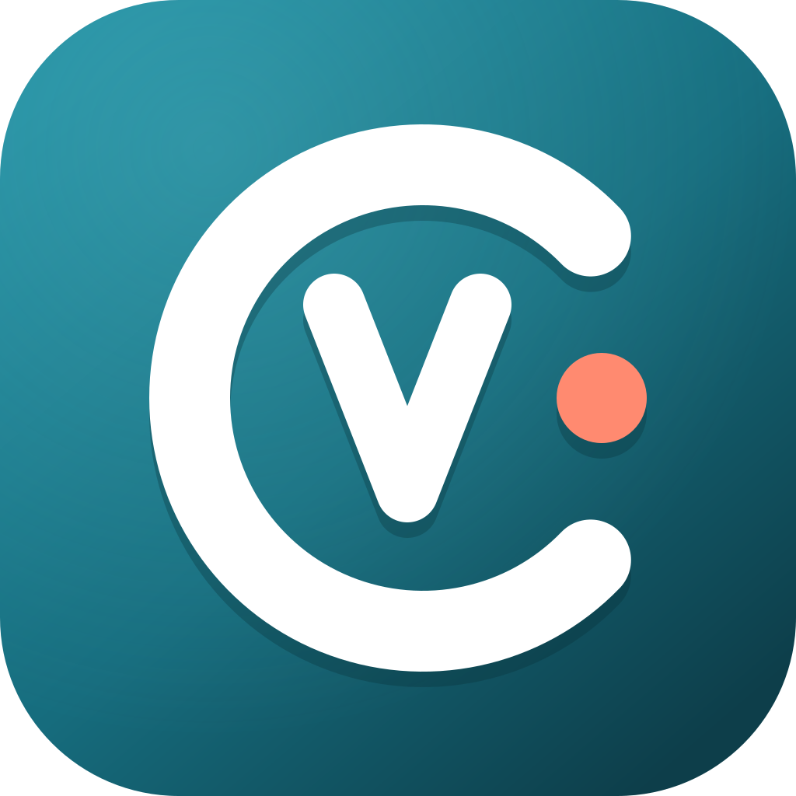

import EcosystemStructuredData from '@site/src/components/EcosystemStructuredData';

<EcosystemStructuredData id="callvault" />

CallVault keeps the phone library at the centre of the experience. A person can play, search, annotate and export recordings there; private cloud backup is something they choose to enable.

**The question:** When does a call recording leave the phone?

## What can the device record?

The app records calls through the audio source a phone makes available. That qualification matters: Android devices and call routes differ, so the page should not promise a uniform capture result on every handset.

## How is a recording found later?

Playback, search and notes make a recording useful after the call. Export is an explicit action from the phone library rather than a reason to move every file to a server by default.

## What stays under the user’s control?

The roster says recordings stay on the phone unless private cloud backup is enabled. I would check that choice in the app before describing its data flow more broadly.

## Open the release

[Visit CallVault](https://callvault.aoneahsan.com)

[Read CallVault documentation](https://callvault-docs.aoneahsan.com)

[See all released Zaions products](/ecosystem/)
