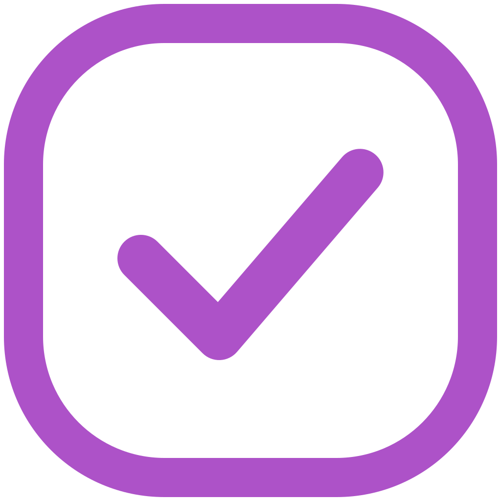

import EcosystemStructuredData from '@site/src/components/EcosystemStructuredData';

<EcosystemStructuredData id="clearhire" />

ClearHire brings resume writing and work-history verification into one career workflow. Its structured profile is the starting record rather than a pile of separately edited copies.

**The question:** What evidence can sit behind a resume?

## How is the resume assembled?

The product has an ATS-friendly builder with structured profiles. Its career tools include bullet writing and ATS checks; the roster records 50 or more tools, not an outcome guarantee for a job search.

## What adds trust to work history?

Verified-employment workflows attach a checkable process to a claim; an employer still judges it.

## What can be opened now?

The released product is linked directly. A hiring manager can inspect its actual resume and profile flow before deciding what the claims mean in practice.

## What could a candidate inspect?

A candidate can begin with a structured profile, turn that record into an ATS-friendly resume and use tools such as bullet writing and ATS checks. The published count is more than fifty career tools, but that number says little about whether a particular resume states the right work. The verified-employment workflow is another inspectable step: it adds a way to check a claim without making the hiring decision for an employer. I would follow one profile through its resume output and then inspect what a verification actually shows. The product can make evidence easier to present. It cannot promise a job offer.

## From the release record

- Build a sharper resume and get discovered.
- ATS-friendly resume builder with structured profiles
- 50+ career tools — from bullet writing to ATS checks
- Verified-employment workflows that add trust

## Open the release

[Visit ClearHire](https://clearhire.aoneahsan.com)

[Read ClearHire documentation](https://clearhire-docs.aoneahsan.com)

[See all released Zaions products](/ecosystem/)
