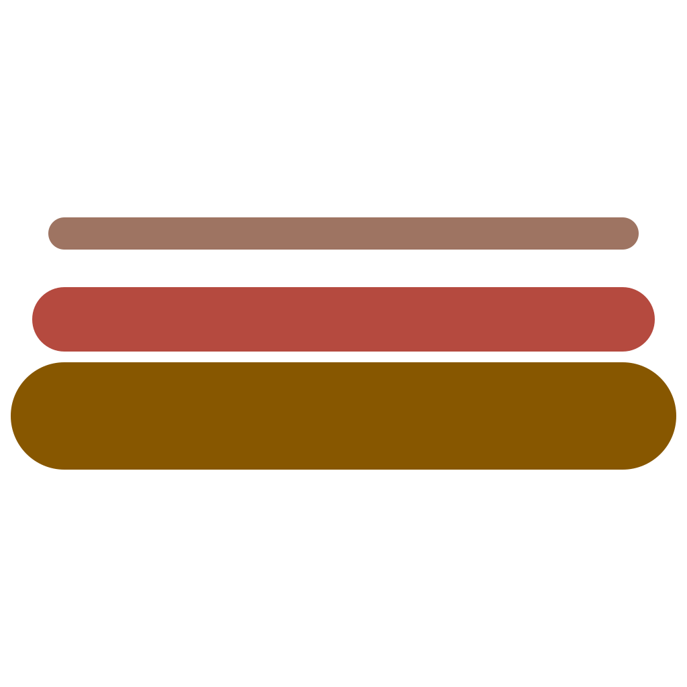

import EcosystemStructuredData from '@site/src/components/EcosystemStructuredData';

<EcosystemStructuredData id="habitforge" />

HabitForge makes consistency visible as a rope. The mark changes with check-ins and also shows where a person stopped, which is more honest than showing only a successful count.

**The question:** What does a habit history show when a streak breaks?

## How does the record look?

The rope thickens with each check-in and frays at a gap. The shape communicates a history that a single streak number would flatten.

## Can the habit be social?

The roster records friends, challenges and a leaderboard that a person can leave. Those are options around the personal record, not a condition for keeping it.

## Where does it run?

The current web and Android apps can be inspected directly.

## What does the rope reveal?

A thickening rope records that check-ins happened; a frayed place records a pause. Both are part of the same history. The social pieces in the release — friends, challenges and a leaderboard — surround that personal record, and the leaderboard can be left. I would inspect a run of check-ins with a gap, then check whether the visual still tells the truth without a contest attached. The web and Android surfaces are both recorded for one account. The portfolio can describe the visible metaphor and the released platforms. It should not turn a habit tool into a promise that somebody will keep a streak.

## From the release record

- Turns consistency into a rope you can see.
- A rope that thickens with every check-in and frays where you stopped
- Friends, challenges and a leaderboard you can leave
- Web and Android, from one account

## Open the release

[Visit HabitForge](https://habitforge.aoneahsan.com)

[Read HabitForge documentation](https://habitforge-docs.aoneahsan.com)

[See all released Zaions products](/ecosystem/)
