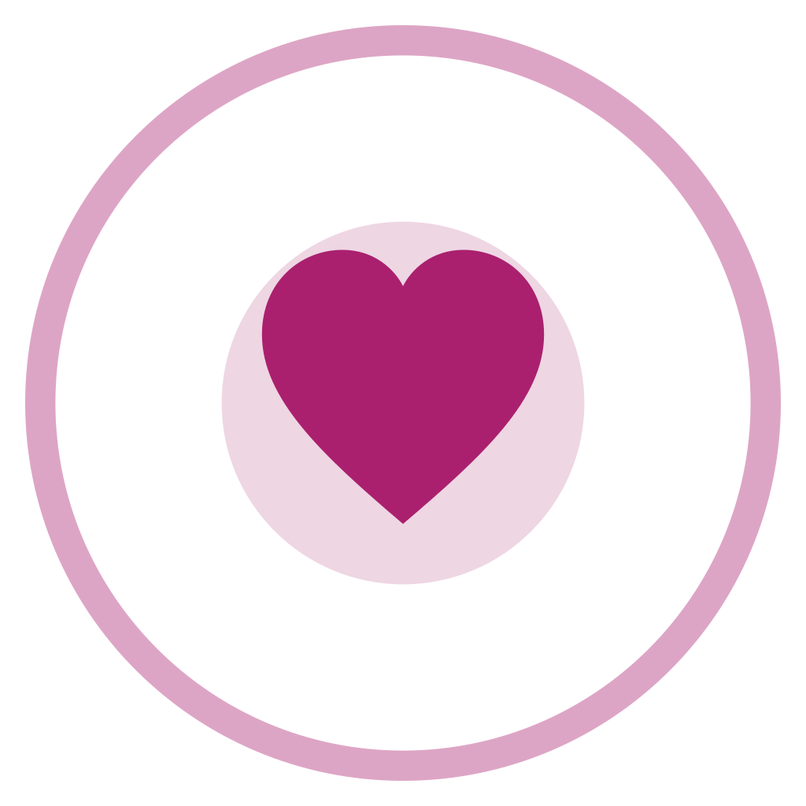

import EcosystemStructuredData from '@site/src/components/EcosystemStructuredData';

<EcosystemStructuredData id="lifewell" />

LifeWell gathers daily health records on web and Android. It covers vitals, water, medicines, sleep and nutrition, plus periods, fertility and baby milestones.

**The question:** Which health notes belong together?

## What can a person record?

Measurements, routines and milestones live in one account, so a person can return to one record.

## How many surfaces are recorded?

Web and Android are listed, with sync across devices. I can link to the released product so a visitor can inspect that behaviour directly.

## Where is the boundary?

This is a record-keeping app. The roster does not claim diagnosis or treatment, and neither should a page about the engineering work behind it.

## Open the release

[Visit LifeWell](https://lifewell.aoneahsan.com)

[Read LifeWell documentation](https://lifewell-docs.aoneahsan.com)

[See all released Zaions products](/ecosystem/)
