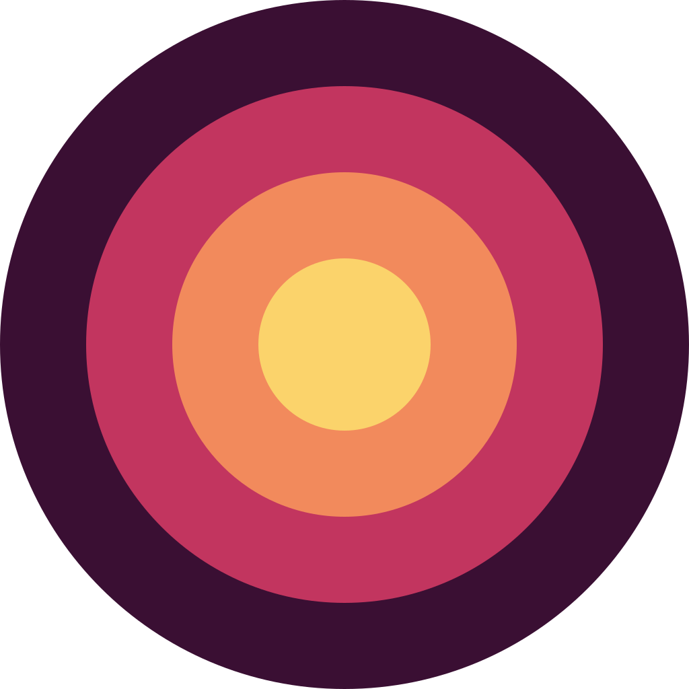

import EcosystemStructuredData from '@site/src/components/EcosystemStructuredData';

<EcosystemStructuredData id="pregnancypal" />

PregnancyPal keeps week-by-week information alongside a person’s own notes on vitals, symptoms, mood and appointments. A PDF export gives the record a form they can bring to a clinician.

**The question:** How can pregnancy notes travel to an appointment?

## What is recorded over time?

The roster names weekly tracking, nutrition and exercise, plus vitals, symptoms, mood and appointments. Those records are useful because they can be revisited in order.

## What does the export change?

A doctor-friendly PDF can be shared outside the app. The person decides when to create that document and whom to show it to.

## Where does the product stop?

The app organises information. It does not replace a clinical assessment; that boundary should be visible anywhere its features are described.

## What travels out of the app?

A PDF made for a clinician. The product also records information week by week — nutrition and exercise alongside vitals, symptoms, mood and appointments — so the export has a sequence to carry rather than one isolated number. I would inspect what a person can select for that document and how the dates read once it is outside the app. The person decides when to make and share the file. Nothing in the release record turns the software into a clinical assessment or advice about a pregnancy. That is why the export is described as a record to bring to a doctor, not an answer from one.

## From the release record

- A calm companion through every week.
- Week-by-week tracking with nutrition and exercise
- Log vitals, symptoms, mood and appointments
- Doctor-friendly PDF export

## Open the release

[Visit PregnancyPal](https://pregnancypal.aoneahsan.com)

[Read PregnancyPal documentation](https://pregnancypal-docs.aoneahsan.com)

[See all released Zaions products](/ecosystem/)
