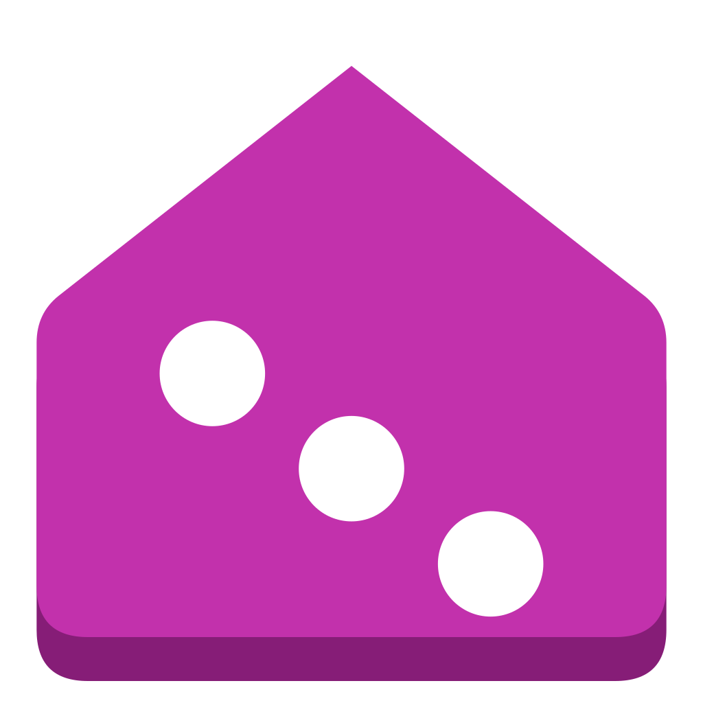

import EcosystemStructuredData from '@site/src/components/EcosystemStructuredData';

<EcosystemStructuredData id="rentparty" />

Rent Party is a property-trading game that can be paused. The bank and deeds remain in place when players return, whether they chose a shared phone, CPU opponents or an online room.

**The question:** How does a property game keep its place between sessions?

## Who can join a game?

Players can pass one phone around, play against CPU characters or open an online room. Those are distinct ways to gather a table without changing the underlying game.

## What does the game remember?

The product handles the bank and keeps deeds in place on resume. That continuity is the reason a paused match can remain a match rather than becoming a new setup.

## What can be checked?

The released game is linked directly. A visitor can inspect the actual flow rather than infer rules from a screenshot of a board.

## What makes a pause honest?

The bank and deeds remain in place when the game resumes. That matters for all three recorded ways to play: passing one phone around, sitting opposite CPU characters or opening an online room. Without the state of the bank and ownership, a paused match would become a fresh setup wearing the old name. I would inspect the transition out of a game and back into it, then check whether each mode presents the same essential state. The release record describes the available modes and continuity. It does not claim a particular rules variant or an outcome for every match.

## From the release record

- Rent Party is a property-trading game that can be paused.
- Players can pass one phone around, play against CPU characters or open an online room.
- The game handles the bank and keeps deeds in place when play resumes.

## Open the release

[Visit RentParty](https://rentparty.aoneahsan.com)

[Read RentParty documentation](https://rentparty-docs.aoneahsan.com)

[See all released Zaions products](/ecosystem/)
